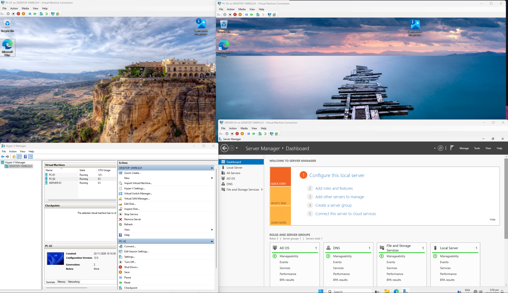

# Windows Server 2025 — Active Directory Home Lab

## Project Overview

Built a virtual Windows Server environment using Microsoft Hyper-V to practice IT infrastructure administration, Active Directory, DNS configuration, networking, and troubleshooting.

The lab simulates a small business network with one domain controller and two Windows 11 client computers.

## Active Directory Administration

Practical administration of a simulated small-business Active Directory environment using Windows Server 2025.

**Completed administrative tasks:**

- Organizational Unit creation and management
- Departmental user account provisioning
- Security group creation and management
- Group membership verification
- Password management and domain authentication

[View Active Directory administration documentation and screenshots](active-directory-administration/README.md)

---

## Troubleshooting Case Studies

### Active Directory — Forced Password-Change Loop

**Status:** Resolved | **Date:** 27 November 2026

Investigated and resolved a recurring domain authentication issue through guided hands-on troubleshooting, recovery preparation and Windows Server maintenance.

**Practical skills demonstrated:**

- Active Directory and Kerberos authentication diagnostics
- Windows Event Viewer and security auditing
- PowerShell troubleshooting
- System State backup and recovery preparation
- Hyper-V network and storage administration
- Windows Server patch management
- Post-maintenance health verification

**Outcome:** Successful domain authentication restored without reinstalling the server or weakening existing security policies. Approximately 21 GB of NVMe storage reclaimed through checkpoint management.

[View the full troubleshooting case study and screenshots](troubleshooting/password-change-loop/README.md)

---

## Lab Environment

| Component | Configuration |
|---|---|
| Hypervisor | Microsoft Hyper-V |
| Host OS | Windows 11 Pro |
| Server OS | Windows Server 2025 |
| Domain Controller | SERVER-01 |
| Domain | lab.test |
| Client Computers | PC-01 and PC-02 |
| Client OS | Windows 11 Enterprise Evaluation |
| Virtual Network | AD-LAB-PRIVATE (Private Switch) |
| Server Roles | Active Directory Domain Services, DNS |

## Network Configuration

| Computer | IP Address | DNS Server |
|---|---|---|
| SERVER-01 | 10.10.10.10 | 10.10.10.10 |
| PC-01 | 10.10.10.20 | 10.10.10.10 |
| PC-02 | 10.10.10.30 | 10.10.10.10 |

All virtual machines use an isolated private network.

## Configuration and Testing

- Installed and configured Windows Server 2025.
- Installed Active Directory Domain Services and DNS.
- Created the `lab.test` Active Directory domain.
- Configured forward and reverse DNS lookup zones.
- Joined both Windows 11 clients to the domain.
- Verified domain authentication using `whoami`.
- Tested network communication and DNS resolution using `ping` and `nslookup`.

## Troubleshooting

**IP Configuration:** Resolved a duplicate IP address conflict between the server and a client.

**DNS:** Investigated DNS resolution issues and configured the required DNS records and reverse lookup zone.

**Windows Activation:** Temporarily connected the clients to Hyper-V's Default Switch to provide internet access for evaluation activation. Removed the temporary adapters afterward and verified internal DNS connectivity.

## Project Status

Core infrastructure configured and tested successfully. Further Active Directory administration and networking exercises are planned.

## Documentation

Detailed configuration notes, troubleshooting records, and screenshots will be added to this repository.
## Lab Screenshots

### Complete Lab Overview

The screenshot shows all three virtual machines running simultaneously, including Windows Server 2025 with Active Directory Domain Services and DNS.

[View all 10 lab screenshots](screenshots/)
