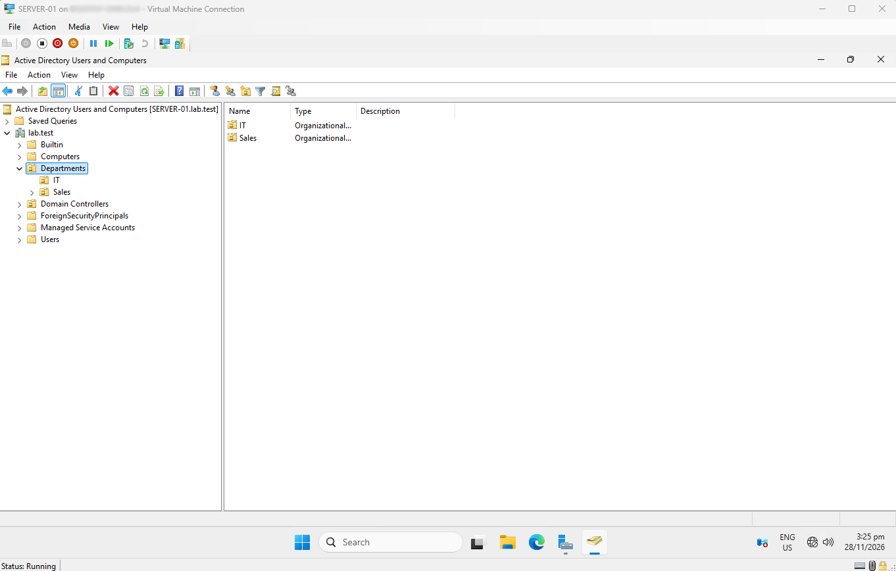
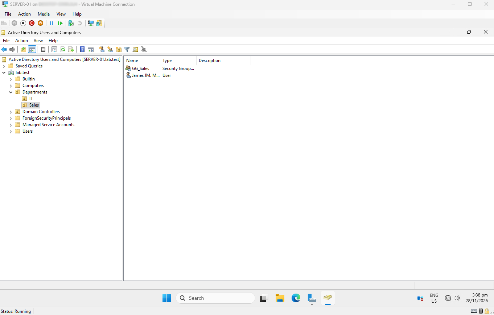
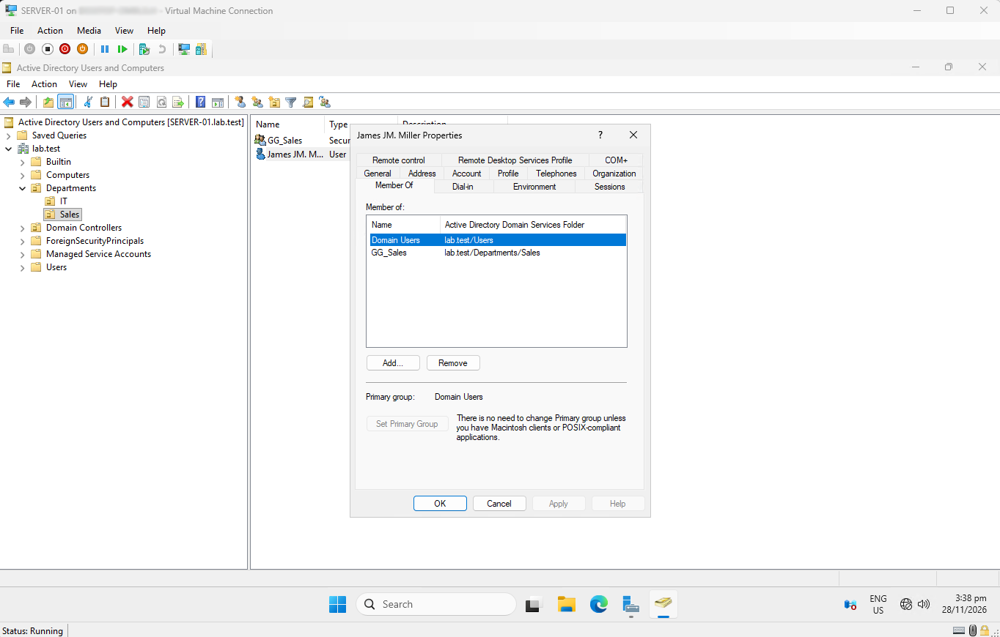
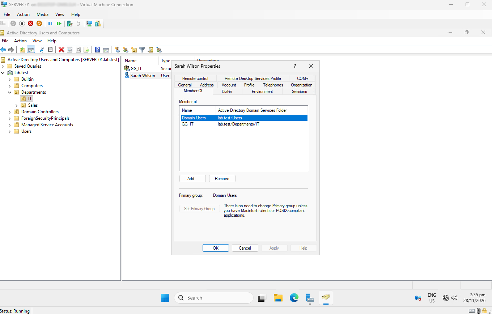

# Active Directory Administration

**Environment:** Windows Server 2025 — Microsoft Hyper-V  
**Domain:** lab.test  
**Domain Controller:** SERVER-01  
**Project Type:** Guided Hands-on Administration  
**Last Updated:** 28 November 2026

## 1. Project Overview

This section documents practical Active Directory administration tasks performed in a virtualized small-business environment.

The objective is to develop practical skills in organizational unit management, user account provisioning, security group administration and centralized identity management.

## 2. Organizational Unit Structure

A departmental hierarchy was created using Active Directory Users and Computers (ADUC).

The structure separates employees into departments and provides a foundation for future Group Policy administration and access management.

### Organizational Hierarchy

```text
lab.test
└── Departments
    ├── Sales
    │   ├── James JM. Miller
    │   └── GG_Sales
    └── IT
        ├── Sarah Wilson
        └── GG_IT
```

## 3. User Account Provisioning

Two fictional employee accounts were created to simulate a small-business environment.

| Employee | Username | Organizational Unit |
|---|---|---|
| James JM. Miller | james.miller | Sales |
| Sarah Wilson | sarah.wilson | IT |

Practical tasks included:

- Creating domain user accounts.
- Configuring usernames and initial passwords.
- Managing first-logon password requirements.
- Testing domain authentication.
- Verifying account configuration.

## 4. Security Group Administration

Departmental security groups were created to establish a foundation for role-based access control.

| Security Group | Department | Assigned User |
|---|---|---|
| GG_Sales | Sales | James Miller |
| GG_IT | IT | Sarah Wilson |

Group memberships were verified through the Member Of tab in Active Directory Users and Computers.

Both employees retained Domain Users as their primary group.

No additional administrative privileges were granted during departmental group assignment.

## 5. Administration Principles

The following concepts were applied during the configuration:

- Organizational Units provide a logical directory structure and support Group Policy management.
- Security groups simplify permission and resource access management.
- OU placement and security group membership are managed independently.
- Departmental group membership provides a foundation for future file-sharing permissions.
- User accounts should receive only the privileges required for their responsibilities.

## 6. Visual Evidence

### Organizational Unit Structure

Departmental hierarchy containing the Sales and IT organizational units.



---

### Sales Department

Sales organizational unit containing the employee account and departmental security group.



---

### Sales Security Group Membership

Verification of James Miller's membership in GG_Sales and Domain Users.



---

### IT Department

IT organizational unit containing the employee account and departmental security group.


---

### IT Security Group Membership

Verification of Sarah Wilson's membership in GG_IT and Domain Users.



## 7. Practical Skills Developed

- Active Directory Users and Computers (ADUC)
- Organizational Unit creation and management
- Domain user provisioning
- Security group creation
- Security group membership management
- Password management
- Domain authentication
- Account configuration verification
- Technical documentation

## 8. Project Status

| Task | Status |
|---|---|
| Organizational Unit hierarchy | Completed |
| Departmental user provisioning | Completed |
| Security group creation | Completed |
| Group membership verification | Completed |
| Domain authentication | Tested |
| Employee department transfers | Upcoming |
| Group Policy administration | Upcoming |
| File sharing and NTFS permissions | Upcoming |

This documentation represents the initial departmental configuration before subsequent employee transfer and access management exercises.

## Related Case Study

[Active Directory Authentication Troubleshooting — Forced Password-Change Loop](../troubleshooting/password-change-loop/README.md)

---

[Return to Main Project](../README.md)
