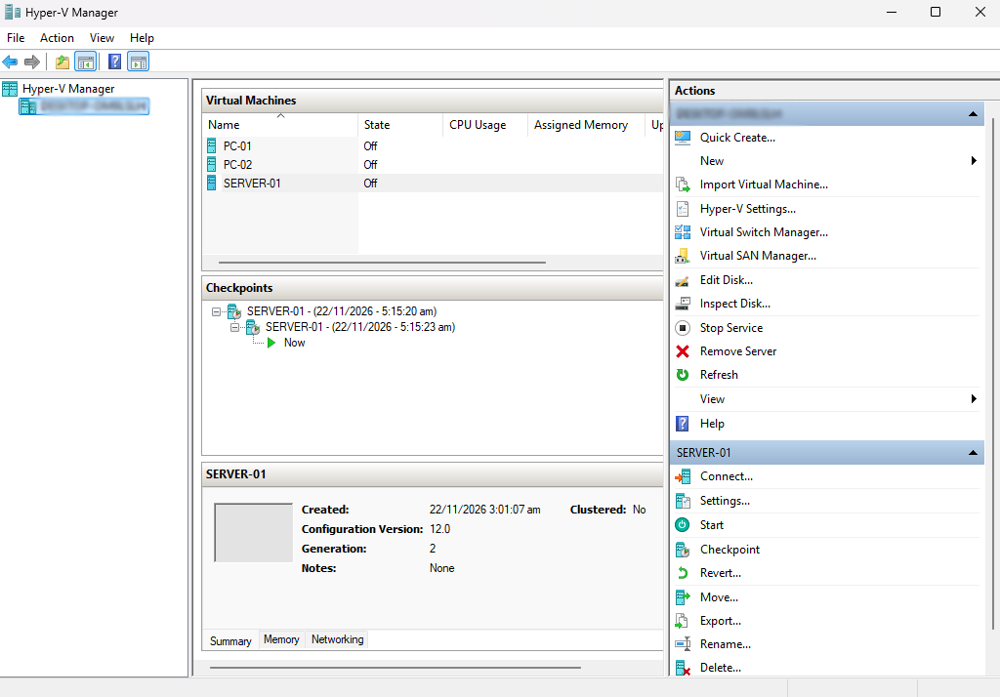
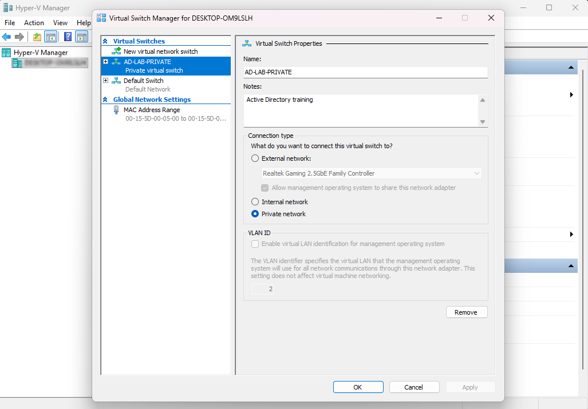
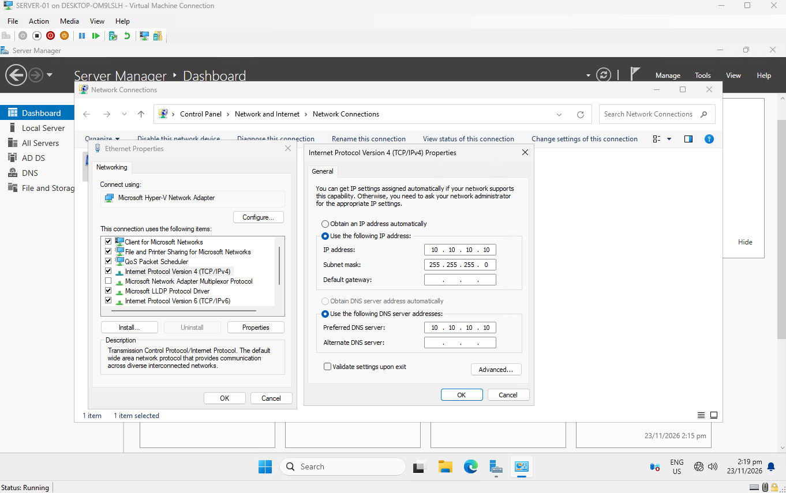
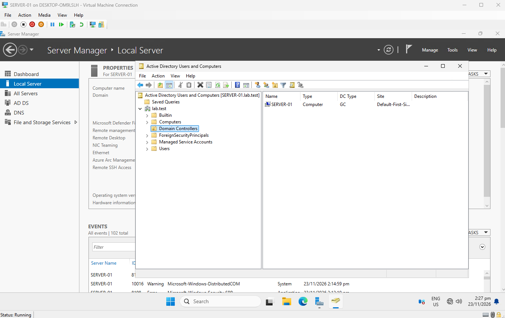
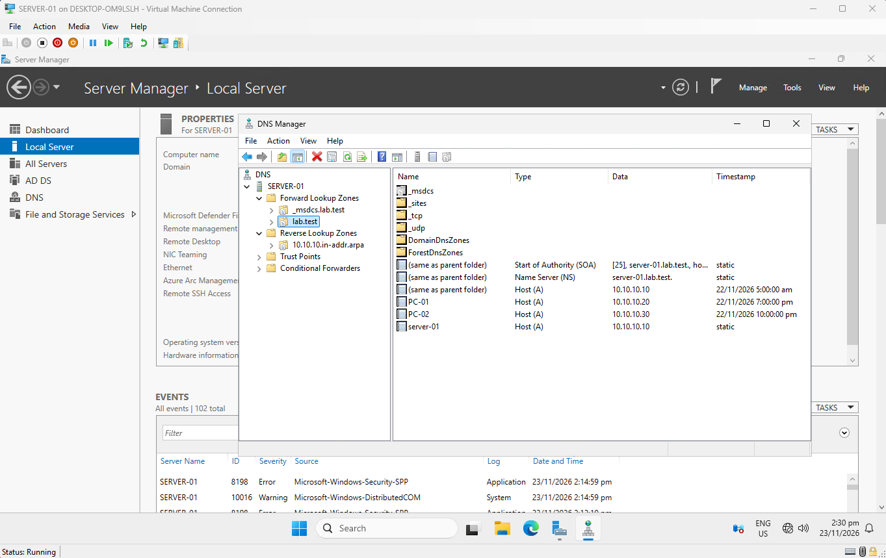
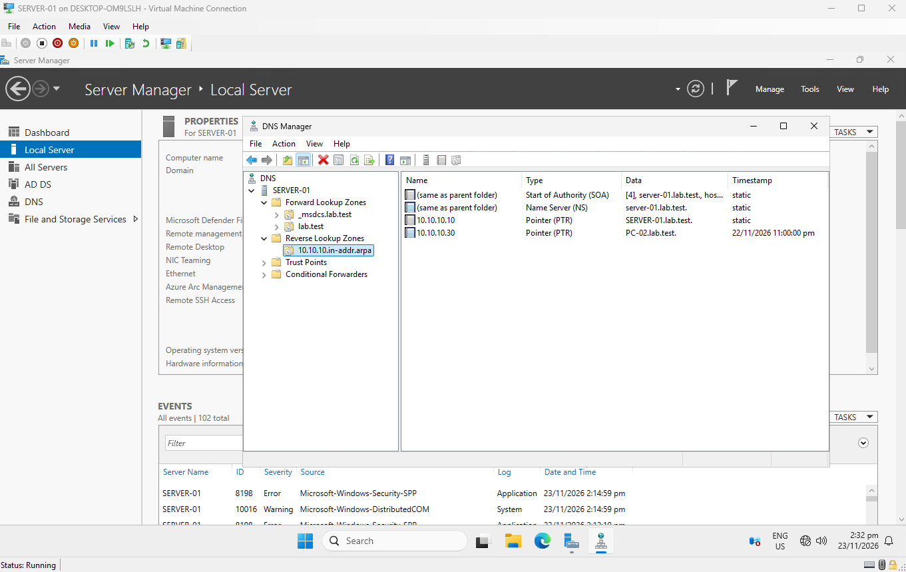
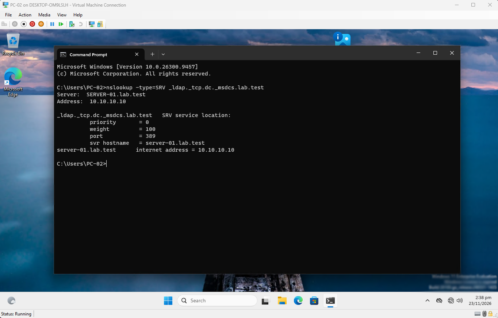
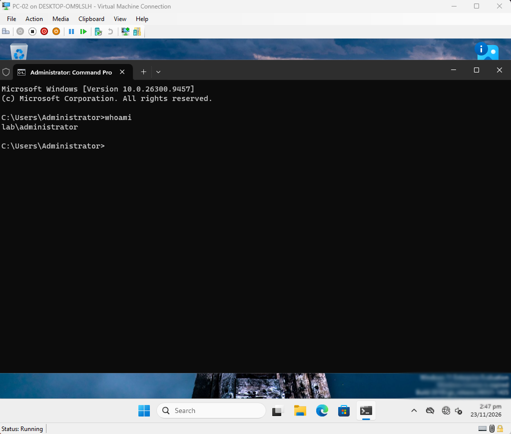
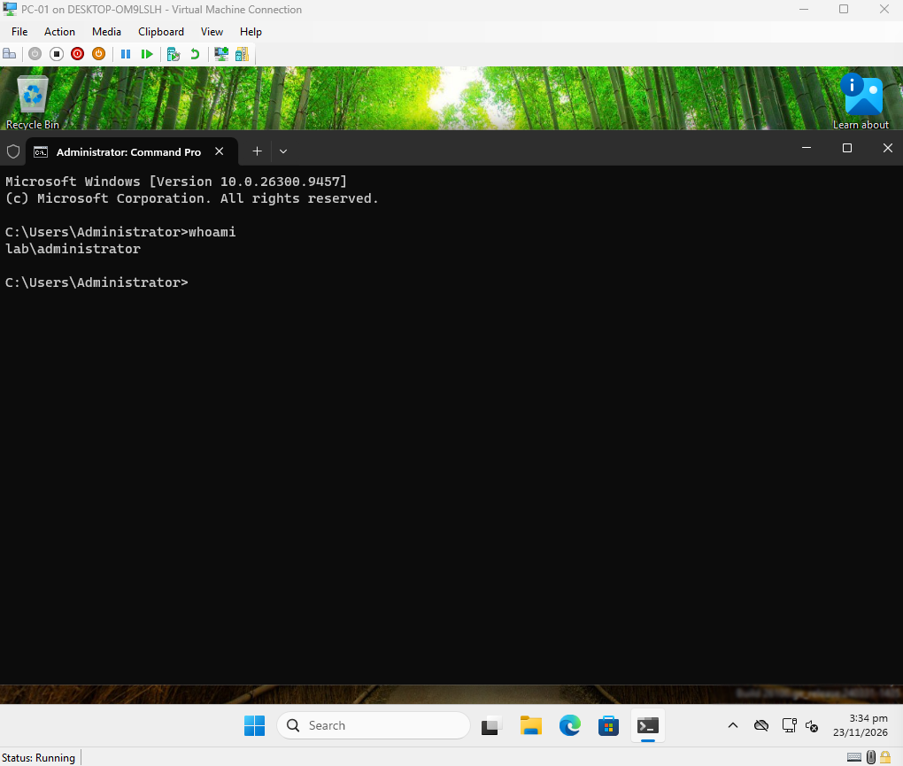
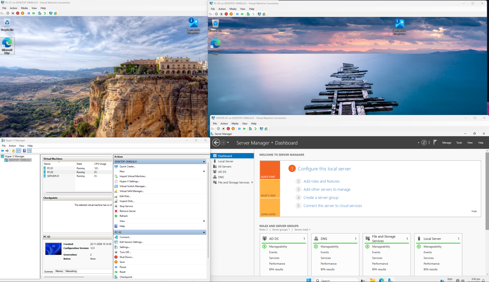

# Active Directory Home Lab — Screenshots

Screenshots documenting the configuration and testing of my Windows Server 2025 Active Directory lab using Microsoft Hyper-V.

[← Back to Main Project](../README.md)

---

## 1. Hyper-V and Network Setup

### Figure 1 — Hyper-V Virtual Machines

Hyper-V Manager showing the three configured virtual machines: SERVER-01, PC-01, and PC-02.

### Figure 2 — Private Virtual Switch

Configured the `AD-LAB-PRIVATE` virtual switch to create an isolated network for communication between the virtual machines.

### Figure 3 — Server IP Configuration

Configured SERVER-01 with static IP address `10.10.10.10`, subnet mask `255.255.255.0`, and preferred DNS server `10.10.10.10`.

---

## 2. Active Directory Configuration

### Figure 4 — Active Directory Domain Controller

Active Directory Users and Computers showing the `lab.test` domain and SERVER-01 in the Domain Controllers organizational unit.

---

## 3. DNS Configuration and Testing

### Figure 5 — DNS Forward Lookup Zone

Configured DNS A records for SERVER-01, PC-01, and PC-02 in the `lab.test` forward lookup zone.

### Figure 6 — DNS Reverse Lookup Zone

Configured a reverse lookup zone with PTR records for reverse DNS resolution.

### Figure 7 — DNS SRV Record Verification

Used `nslookup` on PC-02 to verify that DNS correctly identifies SERVER-01 as the domain controller for `lab.test`.

---

## 4. Domain Authentication

### Figure 8 — PC-02 Domain Authentication

Verified domain authentication on PC-02 using `whoami`, returning `lab\administrator`.

### Figure 9 — PC-01 Domain Authentication

Verified domain authentication on PC-01 using `whoami`, returning `lab\administrator`.

---

## 5. Completed Lab Environment

### Figure 10 — Complete Lab Overview

All three virtual machines running simultaneously in Hyper-V, with Active Directory Domain Services and DNS installed on SERVER-01.

---

[← Return to Main Project](../README.md)
