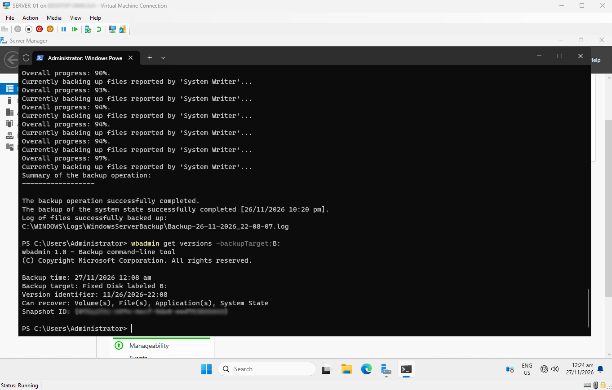
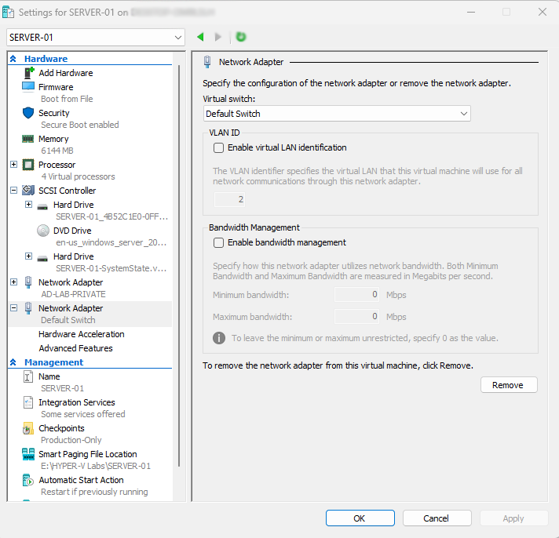
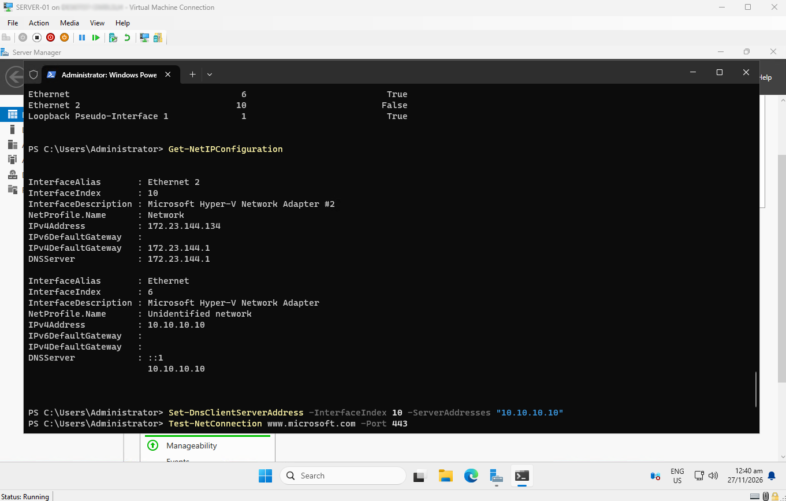
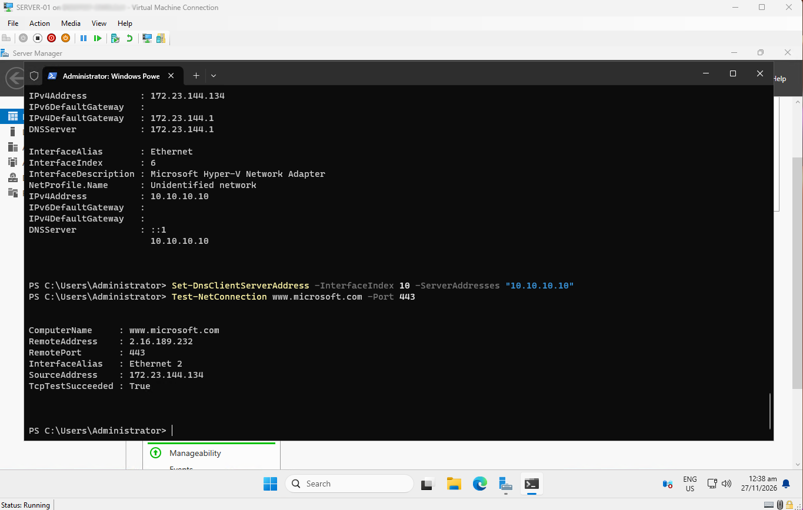
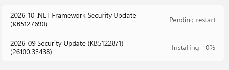
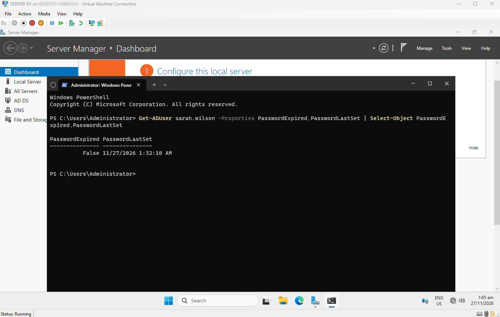

# Active Directory Authentication Troubleshooting
## Windows Server 2025 — Forced Password-Change Loop

**Date:** 26–27 November 2026  
**Environment:** Microsoft Hyper-V Home Lab  
**Project Type:** Guided Hands-on Systems Administration  
**Status:** Resolved

## 1. Incident Overview

During Active Directory user administration exercises, a recurring authentication issue was encountered when newly created domain users were required to change their passwords at first logon.

Windows repeatedly returned users to the password-change screen, preventing successful authentication.

The issue was reproduced with two separate domain accounts, suggesting that it was not isolated to a single user.

### Objectives

- Identify the cause of the authentication failure.
- Preserve the existing Active Directory environment.
- Prepare recovery options before implementing changes.
- Resolve the issue without weakening security policies.
- Verify domain functionality after maintenance.

## 2. Lab Environment

| Component | Configuration |
|---|---|
| Hypervisor | Microsoft Hyper-V |
| Server | Windows Server 2025 Standard |
| Domain Controller | SERVER-01 |
| Domain | lab.test |
| Server IP | 10.10.10.10 |
| Client Computers | PC-01 and PC-02 |
| Client OS | Windows 11 Enterprise |
| Virtual Network | AD-LAB-PRIVATE |
| Original Server Build | 26100.1742 |
| Updated Server Build | 26100.33438 |

## 3. Troubleshooting Methodology

A structured troubleshooting approach was followed:

1. Reproduce the issue.
2. Verify network connectivity.
3. Check domain trust and authentication services.
4. Inspect user account configuration.
5. Review security event logs.
6. Investigate operating system compatibility.
7. Prepare backup and recovery options.
8. Implement the proposed solution.
9. Verify functionality.
10. Perform post-maintenance cleanup.

## 4. Diagnostic Tests

| Diagnostic Test | Result |
|---|---|
| Domain controller discovery | Passed |
| Computer secure channel | Passed |
| Kerberos TCP port 464 connectivity | Passed |
| Active Directory account status | Correct |
| Domain password policy | No obvious cause identified |
| Basic and Enhanced Session testing | Issue persisted |
| Security event log investigation | Authentication failure identified |
| Windows Server build inspection | Early server build identified |

### Diagnostic Commands

Domain controller discovery:

```cmd
nltest /dsgetdc:lab.test /force
```

Domain trust verification:

```powershell
Test-ComputerSecureChannel -Verbose
```

Kerberos password-change port connectivity:

```powershell
Test-NetConnection 10.10.10.10 -Port 464
```

Active Directory account inspection:

```powershell
Get-ADUser sarah.wilson -Properties PasswordExpired,PasswordLastSet,LockedOut,CannotChangePassword
```

Domain password policy inspection:

```powershell
Get-ADDefaultDomainPasswordPolicy
```

Operating system build verification:

```powershell
Get-ItemProperty 'HKLM:\SOFTWARE\Microsoft\Windows NT\CurrentVersion' |
Select-Object ProductName, DisplayVersion, CurrentBuild, UBR
```

## 5. Security Event Investigation

Windows Event Viewer was used to investigate authentication and password-change events.

Relevant event IDs included:

| Event ID | Description |
|---|---|
| 4723 | Password-change attempt |
| 4768 | Kerberos authentication ticket request |
| 4771 | Kerberos pre-authentication failure |
| 4776 | Credential validation |
| 4625 | Failed logon |

Kerberos auditing was initially configured to record successful authentication only.

Failure auditing was enabled to improve diagnostic visibility.

```cmd
auditpol /set /subcategory:"Kerberos Authentication Service" /failure:enable
```

A failed Kerberos authentication event was subsequently captured. However, an event-processing error prevented normal interpretation of its full authentication details.

## 6. Backup and Recovery Preparation

Before updating the domain controller, recovery options were prepared to protect the existing lab environment.

The following tasks were completed:

- Created a Hyper-V production checkpoint.
- Preserved an existing full virtual machine export.
- Installed Windows Server Backup.
- Created a dynamically expanding 50 GB VHDX on separate physical storage.
- Initialized the virtual disk using GPT.
- Created and formatted an NTFS backup partition.
- Performed a System State backup.
- Verified the backup catalog.

### Backup Commands

```powershell
Install-WindowsFeature Windows-Server-Backup

wbadmin start systemstatebackup -backupTarget:B:

wbadmin get versions -backupTarget:B:
```

The System State backup completed successfully and consumed approximately 10.3 GB of virtual volume space.

## 7. Temporary Network Configuration

The domain controller was operating on an isolated private virtual network without internet access.

A second virtual network adapter was temporarily configured using the Hyper-V Default Switch to provide internet connectivity for Windows Update.

The original Active Directory network configuration was preserved.

| Configuration | Private Adapter | Temporary Adapter |
|---|---|---|
| Interface | Ethernet | Ethernet 2 |
| IPv4 Address | 10.10.10.10 | 172.23.144.134 |
| Default Gateway | None | 172.23.144.1 |
| Virtual Switch | AD-LAB-PRIVATE | Default Switch |
| DNS Registration | Enabled | Disabled |

DNS registration was disabled on the temporary interface to reduce the risk of unwanted DNS records.

```powershell
Set-DnsClient -InterfaceIndex 10 -RegisterThisConnectionsAddress $false

Set-DnsClientServerAddress -InterfaceIndex 10 -ServerAddresses "10.10.10.10"
```

External connectivity was verified:

```powershell
Test-NetConnection www.microsoft.com -Port 443
```

Result:

```text
TcpTestSucceeded : True
```

## 8. Solution Implementation

The original Windows Server 2025 installation was running an early operating system build.

Following the diagnostic investigation, an operating system update was selected as the proposed corrective action.

| Stage | OS Build |
|---|---|
| Before maintenance | 26100.1742 |
| After maintenance | 26100.33438 |

Windows security and .NET Framework updates were installed, followed by a controlled server restart.

The server successfully booted after the update.

## 9. Post-Update Verification

Critical Active Directory services were checked:

```powershell
Get-Service NTDS,DNS,Netlogon,KDC,DFSR
```

All five services reported a Running status.

Additional verification included:

```powershell
dcdiag /test:SysVolCheck

Get-SmbShare -Name SYSVOL,NETLOGON

Resolve-DnsName server-01.lab.test -Type A -Server 10.10.10.10
```

Historical DFS Replication and System event warnings were investigated separately.

Subsequent successful DFS Replication events, SYSVOL readiness and network share availability indicated normal operation.

The temporary internet adapter was removed, restoring the original isolated network configuration.

## 10. Incident Resolution

The affected domain user was tested again after the server update.

The mandatory password change completed successfully, followed by a successful domain login.

Active Directory independently confirmed the password change:

```powershell
Get-ADUser sarah.wilson -Properties PasswordExpired,PasswordLastSet |
Select-Object PasswordExpired,PasswordLastSet
```

Result:

```text
PasswordExpired : False
PasswordLastSet : 11/27/2026 1:32:10 AM
```

### Resolution Summary

- Forced password-change loop resolved.
- Domain user authentication successful.
- Existing Active Directory configuration preserved.
- No server reinstallation required.
- No security policies weakened.
- No additional user privileges granted.

The operating system update appears to have resolved the issue. The precise underlying software defect was not independently confirmed.

## 11. Post-Maintenance Cleanup

After verifying server functionality, unnecessary recovery checkpoints were removed through Hyper-V Manager.

The System State backup disk was safely taken offline and detached from the virtual machine.

A new full VM export was created to preserve the updated server configuration.

| Storage Operation | Result |
|---|---|
| Server checkpoints removed | 3 |
| NVMe storage reclaimed | Approximately 21 GB |
| Old VM export removed | 15.6 GB |
| Updated VM export retained | 24.5 GB |
| System State backup | Retained separately |
| Remaining server checkpoints | 0 |

The backup catalog and exported file structure were verified. A full restoration test was not performed.

## 12. Final Health Verification

```powershell
dcdiag /test:Advertising /test:Services /test:SysVolCheck /test:NetLogons /q
```

No errors were reported by the selected tests.

The server successfully booted after checkpoint removal, and the updated Active Directory configuration remained intact.

## 13. Practical Skills Developed

- Active Directory administration
- Windows Server troubleshooting
- Kerberos authentication diagnostics
- Domain trust verification
- Windows Event Viewer
- Security auditing
- PowerShell administration
- Hyper-V network configuration
- Virtual disk provisioning
- GPT partitioning and NTFS formatting
- System State backup
- Windows Server patch management
- Domain controller health verification
- Backup retention and checkpoint management
- Technical incident documentation

## 14. Lessons Learned

This troubleshooting case demonstrated the importance of evidence-based diagnosis, recovery preparation, controlled implementation and post-maintenance verification.

Rather than bypassing the authentication requirement or rebuilding the environment, a systematic troubleshooting approach was used to preserve the existing infrastructure and restore functionality.

This project was completed as guided hands-on training in a personal virtualized IT environment.


---

## 15. Visual Evidence

### System State Backup and Recovery Preparation

Successful System State backup and backup catalog verification using Windows Server Backup.



---

### Hyper-V Dual Network Adapter Configuration

Temporary network adapter connected to the Hyper-V Default Switch while preserving the original private Active Directory network.



---

### IP Configuration and DNS Administration

Verification of both network interfaces, DNS registration settings and configuration of the temporary adapter's DNS server.



---

### Internet Connectivity Verification

Successful external DNS resolution and TCP connectivity on port 443 through the temporary network adapter.



---

### Windows Server Security Updates

Installation of Windows Server 2025 security and .NET Framework updates to address the suspected operating system compatibility issue.



---

### Successful Incident Resolution

Active Directory verification confirming that the mandatory password change completed successfully. The password expiration flag was cleared and a new password timestamp was recorded.



---

[Return to Main Project](../../README.md)
